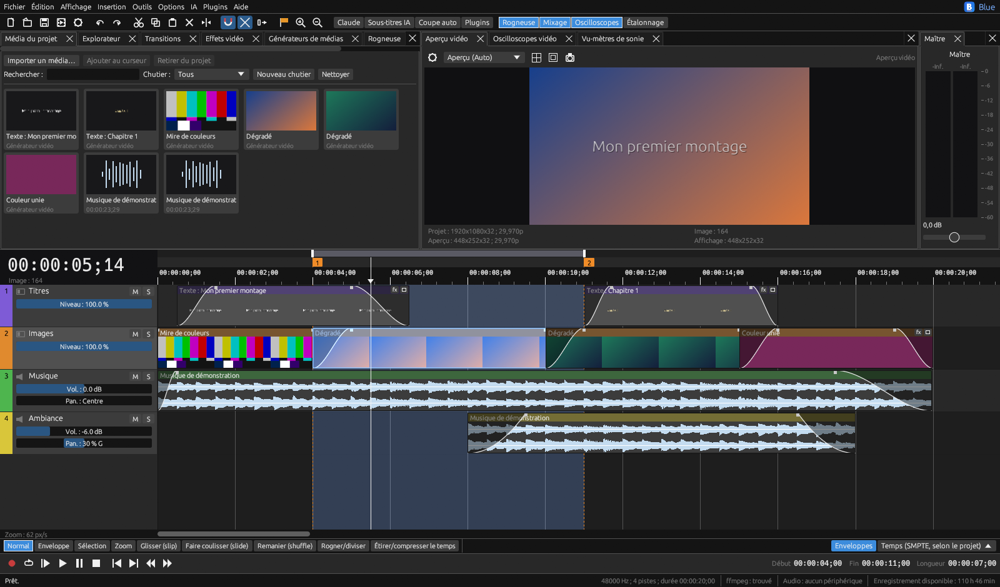

# Blue Edit

Logiciel de **montage vidéo à pistes** pour Windows, macOS et Linux, écrit en Rust (egui).
Ligne de temps multipiste, enveloppes et images clés, transitions, effets, étalonnage, table de mixage,
oscilloscopes, sous-titres automatiques et rendu avec ffmpeg.



## Télécharger

Les versions prêtes à l'emploi sont dans les [releases](https://github.com/xLaugh/BlueEdit/releases/latest).

| Système | Fichier | Remarques |
|---|---|---|
| Windows | `BlueEdit-…-Setup.exe` | Installateur, sans droits administrateur. ffmpeg inclus. |
| Windows | `BlueEdit-…-windows-portable.exe` | Un seul fichier, rien à installer. ffmpeg doit être dans le PATH ou à côté du programme. |
| Linux | `BlueEdit-…-x86_64.AppImage` | Toutes distributions : `chmod +x` puis lancer. Installer ffmpeg. |
| Debian / Ubuntu | `blue-edit_…_amd64.deb` | `sudo apt install ./blue-edit_…_amd64.deb` (installe aussi ffmpeg). |
| Linux | `blue-edit-…-linux-x86_64.tar.gz` | Décompresser puis `./install.sh` (installation pour l'utilisateur). |
| macOS 11+ | `BlueEdit-…-macos-universal.dmg` | Apple Silicon et Intel. Installer ffmpeg : `brew install ffmpeg`. |

**macOS** : l'application n'est pas signée par Apple. Au premier lancement, faites clic droit > *Ouvrir*
(ou `xattr -dr com.apple.quarantine "/Applications/Blue Edit.app"`).
**Windows** : SmartScreen peut avertir d'un éditeur inconnu ; *Informations complémentaires* > *Exécuter quand même*.

## Fonctions

- **Interface** : fenêtres ancrables (onglets, fenêtres flottantes), dispositions prêtes à l'emploi et personnelles,
  thèmes clair et sombre, 10 langues (français, anglais, allemand, espagnol, italien, portugais, polonais,
  japonais, coréen, chinois).
- **Montage** : outils Sélection, Enveloppe, Glisser, Faire coulisser, Remanier, Rogner/diviser, Étirer ;
  coller en insérant, prises multiples, régions et marqueurs, groupes de pistes, timelines imbriquées,
  multicaméra synchronisée par l'audio, historique complet.
- **Vidéo** : mouvement de piste 2D avec images clés, 9 modes de composition, masques, incrustation sur fond vert,
  stabilisation, suivi de mouvement, titres animés, diaporama Ken Burns, étalonnage (roues, courbes, LUT `.cube`),
  oscilloscopes (vectorscope, histogramme, forme d'onde, parade RVB), proxys et aperçu RAM.
- **Audio** : table de mixage avec bus et effets d'insertion, automatisation, égaliseur, compresseur, réverbération,
  réduction de bruit, mesure de sonie (LUFS), mixage 5.1, enregistrement dans une piste.
- **IA** : sous-titres automatiques en local (whisper.cpp via ffmpeg, rien n'est envoyé sur Internet),
  coupe automatique des silences, et un assistant de montage optionnel (Claude, avec votre propre clé API Anthropic).
- **Échanges** : import/export EDL, FCPXML (Final Cut Pro, DaVinci Resolve), XML Premiere Pro, SRT ;
  rendu MP4, MOV ou MKV (H.264, HEVC, ProRes, VP9 ; encodage par le processeur, NVIDIA NVENC, Intel QSV ou AMD),
  rendu par lots, file d'attente.

## ffmpeg

Blue Edit utilise [ffmpeg](https://ffmpeg.org) pour lire et exporter les vidéos. Il le cherche à côté du programme,
dans le `PATH`, puis dans les dossiers habituels (Homebrew, MacPorts, `/usr/bin`, `/snap/bin`).
L'installateur Windows et le paquet `.deb` s'en occupent ; ailleurs, installez-le avec le gestionnaire de paquets.

## Compiler

Rust stable (<https://rustup.rs>) puis :

```bash
cargo run --release
```

Linux (Debian/Ubuntu) : `sudo apt install build-essential pkg-config libasound2-dev libgtk-3-dev libxkbcommon-dev libgl1-mesa-dev libwayland-dev ffmpeg`
(Fedora : `sudo dnf install gcc pkgconf alsa-lib-devel gtk3-devel libxkbcommon-devel mesa-libGL-devel ffmpeg`).

Paquets, dans `dist/` :

| Système | Commande | Résultat |
|---|---|---|
| Windows | `powershell -File packaging\build-windows.ps1 -WithFfmpeg` | portable `.exe` + installateur (Inno Setup 6) |
| Linux | `bash packaging/build-linux.sh` | `.tar.gz`, `.deb`, AppImage si `appimagetool` est présent |
| macOS | `bash packaging/build-macos.sh` | `Blue Edit.app` universelle + `.dmg` (avec `rustup target add aarch64-apple-darwin x86_64-apple-darwin`) |

Les réglages, plugins et modèles sont rangés dans `%LOCALAPPDATA%\Blue Edit` (Windows),
`~/Library/Application Support/Blue Edit` (macOS) ou `~/.local/share/Blue Edit` (Linux).

## Publier une version

1. Mettre à jour `version` dans `Cargo.toml` (et `Cargo.lock` avec `cargo build`).
2. Facultatif : écrire les notes dans `docs/release-vX.Y.Z.md`.
3. `git tag vX.Y.Z && git push origin vX.Y.Z` : l'action [Release](.github/workflows/release.yml) construit
   les six paquets et publie la release.

## Licence

[GNU GPL v3](LICENSE). L'installateur Windows inclut ffmpeg (build de [Gyan Doshi](https://www.gyan.dev/ffmpeg/builds/), GPL).
